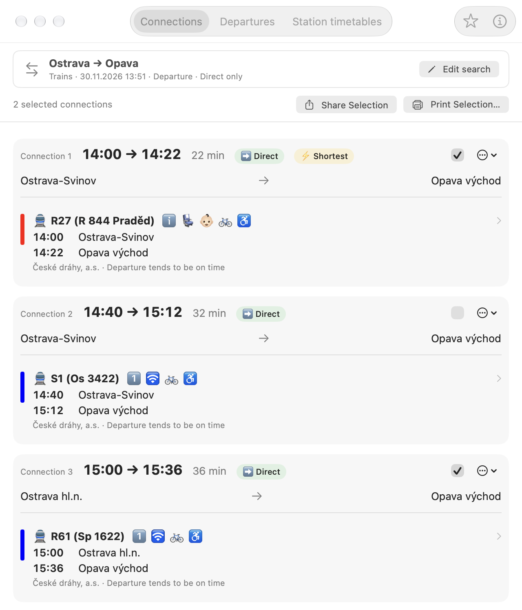

# 🌰 Kaštan for macOS

A native SwiftUI app for connections, station boards, and urban public-transport timetables on macOS 13 or newer.
It uses the [Kaštan Swift library](https://github.com/Glutexo/kastan) to search IDOS.

See [downloads](https://github.com/Glutexo/kastan-macos/releases) for app releases. Downloads up to and including
0.10.0 are available in the [original repository](https://github.com/Glutexo/kastan/releases/tag/v0.10.0).

To run from source, open `KastanApp/KastanApp.xcodeproj` and run the shared `KastanApp` scheme in Xcode.
The [documentation](docs/README.md) covers features, testing, and distribution.
